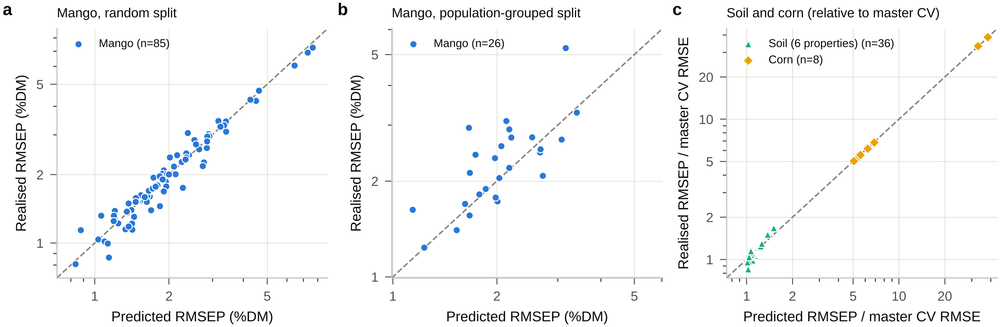
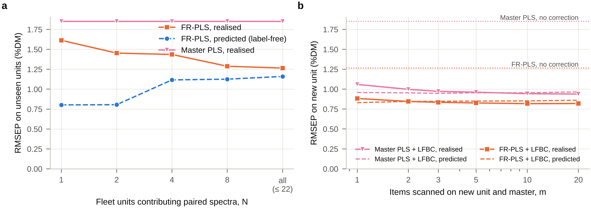
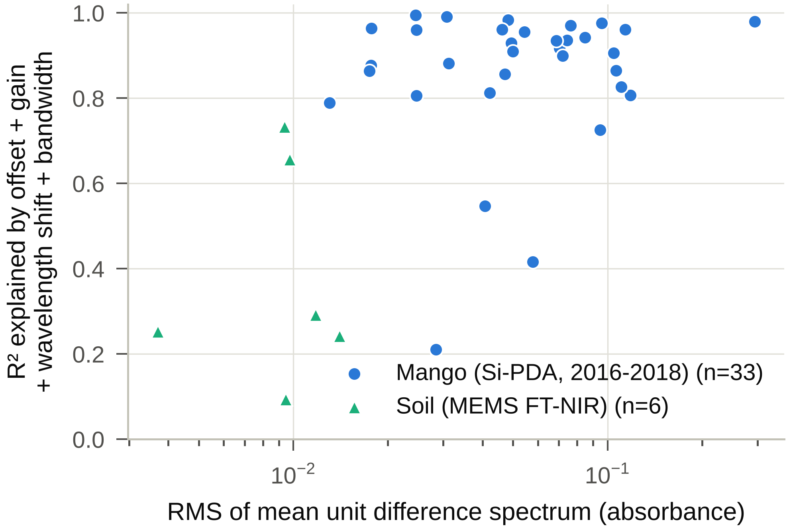

**P N Bhargav Teja**^a,\*^, **[Second Author]**^b^

^a^ [Affiliation of P N Bhargav Teja, City, Country]
^b^ [Affiliation of Second Author, City, Country]

\* Corresponding author. E-mail address: [corresponding e-mail]

## Highlights

- Handheld NIR units are modelled as a random population, not master–slave pairs.
- A model's error on unseen units is predicted without fleet reference values.
- Predicted and realised unit errors agree closely across 25 handheld mango units.
- Fleet-risk PLS fixes its penalty weight from the risk it minimises.
- Five paired items qualify a new unit: accept, bias-correct or reject.

## Graphical abstract

{width=100%}

## Abstract

**Background:** Handheld near-infrared (NIR) spectrometers are deployed as fleets of nominally identical units, yet one calibration, built on one unit, is used on all of them, including units bought later. Calibration transfer treats pairs of instruments and is judged with reference values from the secondary instrument. Fleet operators therefore cannot know, without laboratory analyses on every unit, how accurate a calibration will be on unseen units, how to calibrate for the fleet, or whether a new unit is fit for use.

**Results:** Treating units as a random population, we derive a target-label-free estimator of the error of any linear calibration on a given unit and on unseen units, using only the master's cross-validation and replicate scans and items scanned on several units, and fleet-risk PLS (FR-PLS), whose regularisation weight follows from the risk it minimises. In leave-one-unit-out deployment across 30 handheld mango dry-matter units (six seasons), predicted and realised unit errors agreed (r = 0.98; r = 0.69 when transfer and test fruit came from different populations), and FR-PLS reduced the error on unseen units by 36 % (median per unit), outperforming EPO and GLSW tuned by the same criterion and not differing from a calibration that requires fleet reference values. Five paired fruit sufficed to qualify a new unit. A seven-unit handheld soil fleet with small unit effects served as a negative control, and a three-instrument corn benchmark confirmed the ranking.

**Significance:** Fleet calibration turns multi-unit deployment into a quantified, laboratory-free procedure: calibrations are released with their expected error on future units, built to minimise it, and each new unit is qualified from five paired scans.

**Keywords:** Calibration transfer; Handheld NIR spectroscopy; Instrument fleet; Partial least squares; Prediction error; Model robustness

## 1. Introduction

Near-infrared (NIR) spectroscopy has moved from the laboratory bench to the field [@Pasquini2018; @Bec2021]. Handheld and miniaturised spectrometers are now sold in quantity and operated as *fleets*: dozens of nominally identical units are used by growers, packhouses, soil-testing services and regulators, each expected to give the same answer for the same sample. The Australian mango industry, for example, sets harvest timing from dry-matter (DM) predictions made in-orchard with handheld short-wave NIR units [@Walsh2020; @Anderson2020; @Anderson2021], and handheld MEMS FT-NIR units are being adopted for farm-scale soil-carbon monitoring [@Sanderman2025; @Mitu2024; @Partida2025]. In both cases a single calibration, developed with laboratory reference analyses on one or a few units, is distributed to every unit in the fleet, including units that are bought after the calibration was made.

Unit-to-unit differences in wavelength registration, detector gain, optical throughput and bandwidth make this distribution risky [@Workman2018; @Hayes2016; @Greensill2002]. The classical answer is calibration transfer: measure transfer (standardisation) samples on a master and a slave instrument and correct either the spectra (direct and piecewise direct standardisation, PDS [@Wang1991; @Bouveresse1996]), the predictions (slope/bias correction) or the model (orthogonal projections, EPO, TOP, GLSW, Tikhonov regularisation, domain-invariant PLS [@Roger2003; @Andrew2004; @Martens2003; @Kalivas2009; @NikzadLangerodi2018AC]). Recent work in this journal has continued to refine the master–slave problem, for example standard-free transfer by likelihood maximisation [@UCTLMIR2026], two-stage PDS-plus-fine-tuning [@PDSFT2026] and transfer protocols for multisensor systems [@Multisensor2026]. Penalising the variation of predictions between repeated measurements of the same object is also the principle of conditional-variance regularisation and anchor regression in statistics [@HeinzeDeml2021; @Rothenhausler2021], of graph-based and multi-domain PLS transfer [@NikzadLangerodi2021; @Mikulasek2023], and of recent instrument-shift augmentation [@Ren2026], and reference-free model selection after a change of measurement conditions has been proposed by Spiers and Kalivas [@Spiers2021AC; @Spiers2021JCIM]. Across this literature, however, the object of study is one *pair* of instruments (occasionally three to six [@Woody2004; @Ciza2022; @Zhang2022; @Robert2024]), the regularisation strength is a tuning parameter, and the performance of a transfer method is judged on the secondary instrument it was tuned on, usually with labelled samples of that instrument.

Fleets pose three questions this paradigm does not answer. First, **before** a calibration is released: how accurate will it be on units that have never been seen — and can this be known without sending samples to a laboratory for every unit? Second, how should the calibration itself be built so that it is accurate across the *population* of units, rather than on the master? Third, when a new unit arrives: is it fit for purpose as is, after a simple correction, or not at all — and how many samples are needed to decide? The largest fleet study to date standardised 66 milk mid-infrared analysers to a master one at a time and used master–slave prediction differences on common samples as an agreement statistic [@Grelet2017]; for the handheld units used here, bias adjustment from mean difference spectra was already proposed by Hayes et al. [@Hayes2016]; mixed-effects models have been used for site effects in soil spectroscopy [@Potash2026]; and multi-unit handheld studies report that cross-unit performance degrades [@Mitu2024; @Sun2019]. and our own earlier work calibrated prediction *intervals* for new instruments and seasons by group-conformal prediction on the same mango data [@GroupConformal2026], which requires labelled data from several instruments. None of these treats the units as a random sample from a population, predicts the point-prediction error on an unseen unit without reference values from the fleet, or derives the calibration objective — including its regularisation weight — from that population.

This paper develops such a framework — *fleet calibration* — and tests it on what are, to our knowledge, the two largest public multi-unit NIR data sets: 85 401 spectra of mango fruit measured with 31 handheld units over seven seasons, in which thousands of fruit were scanned on up to eleven units [@MangoData], and 36 622 spectra of 2 106 soils measured with seven handheld MEMS FT-NIR units [@NeoSpectraData], complemented by the classical three-instrument corn benchmark. The contributions are:

1. an estimator of the mean squared error a calibration will have on an unseen unit (fleet risk) and on a specific unit (unit risk) that is **target-label-free** — it needs reference values only for the master's calibration set, not for any item scanned on another unit — built from a textbook error identity, the master's cross-validation and replicate scans, and items scanned on the master and on other units;
2. **fleet-risk PLS (FR-PLS)**, a calibration that minimises the estimated fleet risk, whose regularisation weight follows from the risk being minimised instead of being tuned, and a fleet-risk criterion for choosing the number of latent variables, which can equally be used to tune existing transfer methods (EPO, GLSW) without target labels;
3. a **label-free qualification rule** for a newly delivered unit (accept / bias-correct / re-calibrate) and the number of paired items it requires;
4. **fleet design curves** — how much the number of fleet units and of paired items matter — and a physical decomposition of unit effects into offset, gain and wavelength-shift components.

The framework is deliberately linear and PLS-based: it adds no new hyper-parameters to the workflow analysts already use [@OldAdvice2026; @Validation2026], and its outputs (an expected RMSEP and a decision per unit) are the quantities a fleet operator needs.

## 2. Theory

### 2.1. The fleet as a population of instruments

Consider a fleet of nominally identical spectrometers (units) $k = 0, 1, 2, \dots$, of which unit 0 (the *master*) carries a calibration built from $n$ labelled scans $(\mathbf{x}_{0j}, y_j)$. A linear calibration (PLS or any other linear model) predicts $\hat y = b_0 + \mathbf{b}^\top \mathbf{x}$ from a pre-processed spectrum. We write a single scan of item $i$ on unit $k$ as

$$\mathbf{x}_{ik} = \mathbf{s}_i + \mathbf{a}_{ik} + \boldsymbol{\varepsilon}_{ik}, \qquad \mathbf{a}_{i0} \equiv \mathbf{0}, \tag{1}$$

where $\mathbf{s}_i$ is the master's noise-free response to item $i$, $\mathbf{a}_{ik}$ is the *unit effect* (offset, gain, wavelength-axis and bandwidth differences; it may depend on the item through gain-type terms) and $\boldsymbol{\varepsilon}_{ik}$ is scan-to-scan variation (detector noise and re-positioning) with covariance $\boldsymbol{\Sigma}_k$. The fleet is regarded as a random sample from the population of units the manufacturer produces; a unit that will be bought next year is a new draw from the same population. The quantity a user needs before deployment is therefore not the error on a particular slave instrument, but the expected squared error on a *randomly drawn unseen unit*, which we call the **fleet risk**

$$R_\mathrm{F}(\mathbf{b}) = \mathbb{E}_{k}\,\mathbb{E}_{i,\varepsilon}\big[(b_0 + \mathbf{b}^\top\mathbf{x}_{ik} - y_i)^2\big]. \tag{2}$$

### 2.2. An exact identity and a label-free risk estimator

Let item $i$ be scanned $r_0$ times on the master (mean spectrum $\bar{\mathbf{x}}_{i0}$) and once on unit $k$, and let $\mathbf{d}_{ik} = \mathbf{x}_{ik} - \bar{\mathbf{x}}_{i0}$ be the *paired difference*. Then, purely algebraically,

$$e_{ik} = \bar e_{i0} + \mathbf{b}^\top \mathbf{d}_{ik}, \tag{3}$$

where $e$ denotes a prediction error. Eq. (3) is the familiar statement that a spectral perturbation changes a linear prediction by its projection on $\mathbf{b}$ [@Olivieri2006; @Lorber1997]; it is the starting point of slope/bias checks between paired instruments [@Mark2018; @Grelet2017]. Its use here is different: taking expectations under model (1) with independent scan noise gives (Supplementary S1)

$$\mathbb{E}[e_{ik}^2] = \mathrm{MSE}_0 + \mathbb{E}\big[(\mathbf{b}^\top\mathbf{d}_{ik})^2\big] - \Big(1+\tfrac{1}{r_0}\Big)\mathbf{b}^\top\boldsymbol{\Sigma}_0\mathbf{b} + 2\,\mathbb{E}\big[(\mathbf{b}^\top\mathbf{s}_i + b_0 - y_i)\,\mathbf{b}^\top\mathbf{a}_{ik}\big], \tag{4}$$

with $\mathrm{MSE}_0$ the single-scan error on the master. Every term except the last can be estimated **without reference values for any item scanned on a unit other than the master** (we call this *target-label-free*; the master's calibration set is of course labelled): $\mathrm{MSE}_0$ by (grouped) cross-validation on the master, $\mathbb{E}[(\mathbf{b}^\top\mathbf{d})^2]$ from items scanned on both the master and fleet units, and $\boldsymbol{\Sigma}_0$ from the master's replicate scans. The last term vanishes when the unit effect is uncorrelated with the master's chemical residual, which is the case for additive unit effects and, to first order, for gain effects on a well-fitted model; we quantify it with labelled pairs in Section 4.2. Dropping it, the target-label-free estimators of the mean squared error on unit $k$ and on the fleet are

$$\hat R_k(\mathbf{b}) = \widehat{\mathrm{MSE}}_0 + \frac{1}{M_k}\sum_{i}(\mathbf{b}^\top\mathbf{d}_{ik})^2 - \Big(1+\tfrac{1}{r_0}\Big)\mathbf{b}^\top\hat{\boldsymbol{\Sigma}}_0\mathbf{b}, \qquad \hat R_\mathrm{F}(\mathbf{b}) = \frac{1}{N}\sum_{k=1}^{N}\hat R_k(\mathbf{b}). \tag{5}$$

$\hat R_k$ is unbiased for the unit's MSE when the cross-term vanishes; RMSEP values reported below are its square root, which is consistent but slightly biased downwards for small $M_k$. Because units, not scans, are the sampling unit of the population, $\hat R_\mathrm{F}$ weights each fleet unit equally, its uncertainty is obtained by resampling units, and an order-statistic interval of the $\hat R_k$ gives a distribution-free prediction interval for the risk of the *next* unit (with $N$ exchangeable units, $[\hat R_{(j)}, \hat R_{(N+1-j)}]$ covers it with probability $(N+1-2j)/(N+1)$).

Splitting the mean of $\mathbf{b}^\top\mathbf{d}_{ik}$ from its variance decomposes the unit risk into the master error, a **bias** term $(\mathbf{b}^\top\bar{\mathbf{d}}_k)^2$ and a **sample-dependent** term. The bias term is removed, up to sampling error, by a bias correction computed from a handful of items scanned on the new unit and the master, $b_0 \leftarrow b_0 - \mathbf{b}^\top\bar{\mathbf{d}}_k$ — the mean-difference bias adjustment used for these instruments by Hayes et al. [@Hayes2016], which we call label-free bias correction (LFBC). Its risk is predicted by Eq. (5) with the squared mean removed and the sampling variance of the estimated offset, $s^2_{\mathrm{F}}/m$, added, where $m$ is the number of paired items on the new unit and $s^2_{\mathrm{F}}$ the between-item variance of $\mathbf{b}^\top\mathbf{d}$ pooled over the fleet units. This yields a three-way decision rule for a new unit that requires no laboratory analysis: *accept* if $\hat R_k^{1/2}$ is within specification, *bias-correct* if only $\hat R_k^{\mathrm{LFBC}\,1/2}$ is, otherwise *re-calibrate*.

### 2.3. Fleet-risk-minimising calibration

Eq. (4) also says which calibration is best for the fleet. Replacing the expectations by their sample versions and ignoring the (small, $\mathbf{b}$-shrinking) noise-correction term, the empirical fleet risk of a model is the master residual sum of squares plus $n$ times the mean squared projection of the paired differences. Its minimiser is the least-squares solution of the augmented system

$$\begin{bmatrix}\mathbf{X}_0 - \mathbf{1}\bar{\mathbf{x}}_0^\top\\ \mathbf{W}^{1/2}\mathbf{D}\end{bmatrix}\mathbf{b} \approx \begin{bmatrix}\mathbf{y} - \bar y\mathbf{1}\\ \mathbf{0}\end{bmatrix}, \qquad w_{ik} = \frac{n}{N\,M_k}, \tag{6}$$

where $\mathbf{D}$ stacks the paired differences of all fleet units (not re-centred, so that unit offsets are penalised) and the weights give every unit the same total influence. We solve Eq. (6) with PLS and call the result **fleet-risk PLS (FR-PLS)**. Eq. (6) has the form of Tikhonov-regularised calibration transfer [@Kalivas2009; @Kunz2010JC; @Kalivas2012], but with two differences that matter in practice: (i) the regularisation weight is not a tuning parameter — it is fixed at $w_{ik} = n/(NM_k)$ by the risk being minimised, so that no labelled target samples are needed to choose it; and (ii) the difference block pools many units, so that the calibration is made insensitive to the *population* of unit effects rather than to one secondary instrument. The same augmented least-squares structure underlies the WinISI repeatability-file practice, conditional-variance penalties for repeated observations [@HeinzeDeml2021] and graph-based transfer [@NikzadLangerodi2021]; projection methods built from the same difference matrix — EPO [@Roger2003], TOP [@Andrew2004] and GLSW [@Martens2003] — remove or down-weight the difference subspace instead of penalising it, each with a free parameter. What the fleet view adds is the value of the weight and the population over which the penalty is averaged.

The number of latent variables is chosen to minimise $\hat R_\mathrm{F}$, not the master's cross-validation error. For FR-PLS this is done by *unit-held-out cross-validation*: in fold $f$ the model is fitted without master fold $f$ and without the paired differences of a group of fleet units, and the quadratic term of Eq. (5) is evaluated on the held-out units only, so that no difference spectrum is used both to fit and to assess the model. Applied to the ordinary master PLS, the same criterion (FR-LV) changes only the number of latent variables and needs no refitting; it is a risk-based counterpart of the reference-free model selection of Spiers and Kalivas [@Spiers2021JCIM]. The criterion can tune any transfer method; we use it below to tune EPO and GLSW without target labels.

## 3. Materials and methods

### 3.1. Data sets

**Mango dry matter (31 handheld units).** The public mango DM data set (version 4; [@MangoData]) contains 85 401 Vis-SWNIR interactance spectra (300–1200 nm, 3 nm steps) acquired in Australian orchards from 2015 to 2021 with 31 handheld units of the same commercial model (identified by serial number), together with oven-dry DM of each fruit (13 953 fruit). Many fruit were scanned on several units (up to eleven), typically twice per unit at different positions; this crossed design, collected to support robust calibration [@Anderson2020; @Anderson2021], is what makes a population-level analysis possible. Spectra flagged as outliers by the data owners were excluded. Each season was analysed separately (seasons 2015–2020; 2021 has only four units), so that unit effects are not confounded with between-season changes in fruit population. Pre-processing followed the established mango workflow: Savitzky–Golay second derivative (window 13, quadratic) [@Savitzky1964] on 684–990 nm.

**Soil properties (seven handheld MEMS FT-NIR units).** The NeoSpectra soil library [@NeoSpectraData; @Partida2025] contains NIR spectra (1350–2550 nm) of 2 106 archived, dried and sieved mineral soils from the USDA-NRCS Kellogg Soil Survey Laboratory, scanned (six replicate scans) on nine handheld units by two laboratories, with laboratory reference values. Seven units used the same direct-contact configuration (NEO1–NEO7; 36 622 scans) and constitute the fleet; two units used a different sample accessory and shared ≤ 11 soils with the others and were excluded. Six properties were modelled: organic carbon (OC), total N and cation-exchange capacity (CEC) on a $\log_{10}(x+0.1)$ scale, clay, sand and pH. Spectra were converted to absorbance, standard normal variate-transformed [@Barnes1989] and differentiated (Savitzky–Golay first derivative, window 11).

**Corn (three benchtop instruments).** The classical corn benchmark (80 samples measured on instruments m5, mp5 and mp6, moisture, oil, protein and starch) was included as a small, laboratory-instrument case; Savitzky–Golay first derivative (window 15) was applied.

All pre-processing steps act row-wise and have no fitted parameters, so they cannot carry information between units or between calibration and test items.

### 3.2. Leave-one-unit-out deployment protocol

For each data set (mango season or soil property), the master was chosen by a fixed label-free rule — the unit sharing the most items with other units. Items scanned on the master and on at least one other unit were randomly split into three equal parts: *transfer* items (their scans on the master and fleet units provide the paired differences $\mathbf{D}$; their reference values are never used by label-free methods), *paired test* items and calibration items; items scanned only on the master were added to the calibration set and items never scanned on the master to the test set. Each non-master unit in turn played the role of the **unseen target unit**: it was removed from the fleet, all models and all fleet-risk estimates were computed from the master and the remaining units only, and the realised error was then measured on the target's scans of test items. Errors are reported on paired test items (items also scanned on the master, so that the comparison isolates the unit effect) and, for mango, also on all test items, which adds orchard-population differences. The split was repeated with five seeds (three for soil, twenty for corn) and results were averaged per target unit before any statistics, so that the target unit — the population sampling unit — is the unit of inference.

All calibrations are NIPALS PLS1 [@Wold2001]; grouping cross-validation folds by item keeps the replicate scans of a fruit or soil in the same fold.

### 3.3. Compared calibrations

*Target-label-free methods* use the master's labelled calibration set and the paired spectra of transfer items on fleet units, but no reference value of any transfer item: (i) the master PLS (conventional practice); (ii) FR-LV, the same model with the number of latent variables chosen by minimum $\hat R_\mathrm{F}$; (iii) FR-PLS (Section 2.3); (iv) EPO [@Roger2003] and (v) GLSW [@Martens2003], both computed from the same difference matrix $\mathbf{D}$, each in two versions — at a commonly used default ($k = 2$ components; $\alpha = 0.01$ relative to the largest eigenvalue of $\mathbf{D}^\top\mathbf{D}$) and **tuned without target labels by the fleet-risk criterion** (EPO-FR, GLSW-FR: $k \in \{1,2,3,4,6,8,10,12,15,20\}$, $\alpha \in \{10^{-6},\dots,1\}$ in decades; the projection is built from the difference spectra of one half of the fleet units and the quadratic term of Eq. (5) is evaluated on the other half, and vice versa). For all PLS models up to 30 latent variables were allowed; the master PLS and the EPO/GLSW models chose their number of latent variables by grouped 5-fold cross-validation over items with the one-standard-error rule [@Validation2026].

*Reference methods* use information a fleet operator would not normally have. (vi) **Oracle** EPO, GLSW and Tikhonov transfer [@Kalivas2009]: the parameter is chosen from the grids above (Tikhonov: Eq. (6) with weight $\tau^2 w_{ik}$, $\tau^2 \in \{0.01, 0.03, 0.1, 0.3, 3, 10, 30, 100\}$ at the latent-variable number of FR-PLS; $\tau^2 = 1$, which is FR-PLS itself, is excluded) to give the lowest error *on the target unit's own test items*. Oracles are optimistic by construction and show what per-unit tuning with target reference values could achieve. (vii) Pooled PLS, calibrated on the master data plus the fleet scans of the transfer items **with** their reference values (multi-instrument calibration [@Swierenga2000]; latent variables by grouped cross-validation with the one-standard-error rule).

*Unit-specific correction.* Label-free bias correction (LFBC, Section 2.2) was applied to every target-label-free method and to pooled PLS, using the target unit's own scans of transfer items (on average 10–300 items per unit; Section 4.4 studies how few are needed). Because LFBC uses scans from the target unit, methods with and without LFBC are compared separately.

### 3.4. Robustness to acquisition sessions

In the mango data every fruit was scanned on all its units in one session, and fruit populations are tied to sessions. To ensure that the unit effects learned from transfer fruit are not session effects shared with the test fruit, the protocol was repeated with a **population-grouped split**: whole fruit populations (date × orchard population) were assigned to the transfer, test or calibration part, so that transfer and test fruit never come from the same population. This split leaves fewer target units with both transfer and paired test fruit and was therefore run for the three seasons in which at least five target units remained (2015, 2017, 2018).

### 3.5. Evaluation and statistics

The accuracy of a risk prediction was assessed by the Pearson and Spearman correlations between predicted and realised RMSEP across target units, the median ratio predicted/realised and the median absolute percentage deviation; fleet-level predictions were compared with the root-mean-square of realised RMSEP over the target units of a data set and split. The dropped cross-term of Eq. (4) was estimated with the reference values of the transfer items (used for this check only). Methods were compared on paired-test RMSEP and, for mango, also on the RMSEP over all test fruit. Because the same physical unit appears as a target in several seasons (mango) or for several properties (soil), log RMSEP ratios were averaged per physical unit before inference; the unit of inference is therefore the physical instrument. Differences were tested by the Wilcoxon signed-rank test [@Wilcoxon1945] with Holm correction within each family of comparisons, and equivalence was declared when the 90 % bootstrap confidence interval of the median RMSEP ratio lay within 0.90–1.11 (two one-sided tests at α = 0.05 with a ±10 % margin [@Schuirmann1987]). Unit-effect spectra were decomposed by regressing each unit's mean paired difference (raw absorbance) on a constant, the master's mean spectrum and its first and second wavelength derivatives (offset, gain, wavelength-shift and bandwidth terms); the offset share was computed with uncentred sums of squares, and the remaining offset-free shape was described by the centred $R^2$ of the gain, shift and bandwidth terms.

The label-free qualification rule (Section 2.2) was evaluated as a decision: a unit was defined as fit for use if its realised RMSEP was at most 1.5 times the master's cross-validated RMSE (1.25 and 2.0 as sensitivity values), and false-accept and false-reject rates of the decision based on $m$ paired items were computed over 10 random draws of the items per unit.

All computations were done in Python 3.13 (NumPy, SciPy, scikit-learn) with a PLS1 implementation verified against scikit-learn; unit tests check the exact identity of Eq. (3) and the unbiasedness of Eq. (5) on simulated fleets with known unit-effect covariance.

## 4. Results and discussion

### 4.1. The fleet problem is large for the mango fleet and small for the soil fleet

The master calibrations of the mango fleet were as accurate as published single-instrument mango models (grouped cross-validated RMSE 0.59–1.15 %DM; 11.7 latent variables on average). Deployed unchanged on the other units of the same season, they gave RMSEP between 0.81 and 6.9 %DM on fruit that had also been scanned on the master — root-mean-square over the 62 target-unit/season cases with paired test fruit (25 physical units) 2.39 %DM, 2.7 times the master's own cross-validated error. Most of this excess is a unit-specific bias: correcting each unit's mean offset with its own paired fruit (LFBC) reduced the RMS error to 1.15 %DM. Fig. 5 shows the physical origin. A constant offset made up 90 % (median) of the raw absorbance difference between a unit and the master and is removed by the derivative pre-treatment; of the remaining, offset-free difference, gain, wavelength-shift and bandwidth terms explained a median of 91 % (median absolute wavelength shift 1.2 nm), with gain contributing most. These are the hardware tolerances described for short-wave NIR photodiode-array units [@Greensill2002; @Hayes2016], and they project onto the regression vector mainly as bias. The MEMS FT-NIR soil fleet differed qualitatively: although its unit differences were of similar relative size, only 27 % of their offset-free shape was structured, and the master calibrations lost almost nothing on other units (realised/cross-validated error ratio 1.07, median over the 36 unit × property cases, against 2.1 for mango). This agrees with the similar regression coefficients found across NeoSpectra units by Mitu et al. [@Mitu2024], and makes the soil fleet a natural *negative control*: a useful framework should predict that little is lost and that little is to be gained.

### 4.2. The error on a unit can be predicted without fleet reference values

Fig. 2a compares, for every target unit, the RMSEP predicted by Eq. (5) — from the master's cross-validation and replicate scans and the unit's own scans of transfer items, with no reference value of any item scanned on that unit — with the RMSEP realised on independent paired test items. For the master PLS the agreement was close over almost an order of magnitude: Pearson r = 0.98 (Spearman 0.96) across the 62 mango cases, median ratio predicted/realised 0.99, median absolute deviation 6.9 %. For the soil fleet the median ratio was 1.00 and the median deviation 4.5 % (36 unit × property cases; correlations are not reported for soil because they would be inflated by pooling properties on different scales); for corn the deviation was below 1 %. The dropped cross-term of Eq. (4), estimated with the reference values of the transfer items, was −6 % of the quadratic term for the master PLS in mango and −1 % in soil, i.e. negligible, even though gain differences — which make the unit effect sample-dependent — dominate the mango fleet.

Two qualifications matter for practice. First, the agreement is partly an internal-consistency property of Eq. (3): in the random split, transfer and test fruit of a unit were scanned in the same sessions. When transfer and test fruit came from different orchard populations (population-grouped split, 26 cases in three seasons; Section 3.4), the correlation dropped to r = 0.69 and the median deviation rose to 13 %, while the median ratio stayed close to one (0.98) — the predictions remain unbiased but individual units are predicted less precisely because session-specific effects are not captured by a few paired items. Second, for FR-PLS, whose difference block is fitted, the prediction is less accurate (r = 0.86, median deviation 15 %) and fleet-level predictions are optimistic (below).

Averaged over the fleet, the same estimator predicts the error on a unit that contributes nothing. In leave-one-unit-out deployment the predicted fleet RMSEP of the master PLS was 2.42 %DM against a realised 2.40 %DM (median ratio 1.00 over 310 unit × split cases), and the range of the other units' risks contained the new unit's realised error in 77 % of cases. For the soil fleet the median ratio was 1.01. For FR-LV and FR-PLS the fleet-level prediction was optimistic by 14 % and 12 % (median ratios 0.86 and 0.88) and the order-statistic interval is not valid (coverage 13 %), because the fleet's own difference spectra were used to fit FR-PLS; the unit-held-out cross-validation removes only part of this optimism, and a fleet-risk claim for FR-PLS should therefore be inflated accordingly or validated on held-out units.

### 4.3. Calibrating for the fleet instead of the master

Fig. 3 compares the deployed errors of all calibration strategies relative to the master PLS; Table 1 gives the summary statistics. Results are reported per physical unit (25 mango units with paired test fruit, 30 for all test fruit), with season-wise results averaged per unit before testing.

Choosing the number of latent variables by fleet risk instead of master cross-validation (FR-LV) reduced the RMS error from 2.39 to 1.82 %DM without refitting (on average 10.6 instead of 11.7 latent variables). Building the fleet into the calibration (FR-PLS, Eq. (6)) reduced it to 1.41 %DM; per physical unit the median RMSEP ratio to the master was 0.64 (90 % CI 0.59–0.70; FR-PLS better for 92 % of units; Holm-adjusted p < 0.001) on paired test fruit and 0.69 (0.64–0.76) on all test fruit, where orchard-population differences add error that no unit correction can remove (RMS over all test fruit 2.34 → 1.91 %DM). EPO and GLSW at default settings did not improve on the master (RMS 2.25 and 2.28 %DM). Tuned without target labels by the fleet-risk criterion, both improved substantially (EPO-FR 1.52, GLSW-FR 1.49 %DM) — confirming that the criterion is useful beyond FR-PLS — but FR-PLS remained better than both (median ratios 0.86 and 0.93; p = 0.002 and 0.006). FR-PLS did not differ significantly from pooled PLS, which uses the reference values of every transfer fruit on every fleet unit (median ratio 1.08, 90 % CI 0.98–1.17, p = 0.31); equivalence within ±10 % could not be established.

With the parameter chosen per target unit on that unit's own reference values, the oracles were about 20 % better than FR-PLS (median ratios 1.18–1.23). This is the value of target labels, not of a better principle: the oracle Tikhonov weights clustered around the theoretical weight (τ² = 0.3 or 3 in 45 % of cases, τ² = 1 itself being excluded from the oracle grid) without a systematic direction, i.e. the theory-fixed weight is the appropriate choice when the target is unknown. The label-free-tuned GLSW selected its smallest α in 43 % of cases; as α → 0 GLSW converges to whitening by the difference covariance, so this is a limit rather than a truncated optimum.

When the new unit's own paired items are available, bias correction dominates the remaining differences. FR-PLS+LFBC gave the lowest error of all target-label-free strategies (RMS 0.98 %DM paired, 1.07 %DM all test fruit), was better than master PLS+LFBC for 92 % of units (median ratio 0.90, p < 0.001) and was equivalent within ±10 % to GLSW-FR+LFBC, EPO-FR+LFBC and to the labelled pooled PLS+LFBC (median ratio 1.01, 90 % CI 1.00–1.03).

On the soil fleet all methods were within a few per cent of the master (median ratio of FR-PLS to master 0.95 over six units), as predicted by its small unit effects; on the three-instrument corn benchmark the ranking was the same as for mango (RMS over eight instrument × property cases: master 1.35, FR-LV 0.48, FR-PLS 0.38, pooled 0.36, oracles 0.27–0.30, property units), with FR-PLS better than the master in all eight cases. With one-unit fleets, however, the predicted fleet risk of FR-PLS was optimistic (median ratio 0.55): a single secondary instrument cannot represent a population of instruments (see also Section 4.4).

### 4.4. Robustness to acquisition sessions

Under the population-grouped split the gains of fleet calibration persisted (three seasons, 26 paired cases): RMS RMSEP master 2.51, FR-LV 1.89, FR-PLS 1.50, GLSW-FR 1.58, EPO-FR 1.70, pooled PLS 1.40, master+LFBC 1.55 and FR-PLS+LFBC 1.16 %DM, against 1.97, 1.64, 1.38, 1.48, 1.42, 1.33, 1.09 and 0.92 %DM for the random split of the same seasons. The improvement of FR-PLS over the master is therefore not an artefact of shared sessions; what is lost when sessions differ is mainly precision of the unit-specific risk prediction (Section 4.2) and part of the benefit of bias correction, whose offset is estimated in a different session.

### 4.5. How many units and how many items?

Fig. 4a shows the effect of the number of fleet units contributing paired spectra to FR-PLS (mango 2016–2018, 33 target units, three random unit subsets per size). Paired spectra from a single other unit already reduced the error on unseen units (RMS 1.61 vs 1.85 %DM for the master), and the error decreased further up to about eight units (1.29 %DM; all units 1.27 %DM). The fleet-risk *prediction*, in contrast, was optimistic with one or two units (0.80 %DM predicted) and became usable from four units on (1.12–1.16 %DM predicted against 1.27–1.44 %DM realised). The design rule is therefore asymmetric: a calibration benefits from the paired spectra of even one other unit, but a *claimed* fleet accuracy should be backed by at least four units. The number of paired items per fleet unit mattered little: three items per unit gave the same FR-PLS accuracy as all available items (1.28 vs 1.27 %DM).

Fig. 4b shows the qualification of a new unit as a function of the number $m$ of items scanned on it and on the master (ten random draws of the items per unit and size). Label-free bias correction with a single fruit reduced the master PLS error on the new unit from 1.85 to 1.06 %DM and the FR-PLS error from 1.27 to 0.88 %DM; five fruit gave 0.96 and 0.83 %DM, and more fruit gave little further gain. With the offset-sampling term of Section 2.2, the predicted error after correction matched the realised error (five fruit: 0.95 predicted vs 0.96 %DM realised for the master PLS). The predicted error of the uncorrected unit was informative from the first items on: with five fruit, a single draw gave r = 0.95 (median over draws) between predicted and realised unit RMSEP and a median absolute deviation of 11 %.

Used as a decision (Section 3.5; specification 1.5 times the master's cross-validated RMSE), the accept rule based on five paired fruit classified 90 % of master-PLS unit deployments correctly (false acceptance 8.9 % of unfit units, false rejection 12.1 % of fit units). Without qualification, 66 % of the unit deployments of the master PLS were out of specification; after applying the three-way rule (accept / bias-correct / reject), 36 % of units were accepted as is, 55 % bias-corrected and 9 % rejected, and only 14 % of the deployed units were out of specification. For FR-PLS, which leaves fewer units out of specification to begin with (39 %), five fruit gave 87 % correct decisions and 9 % of deployed units out of specification. A practical protocol for a new unit is therefore: scan five items on the new unit and on the master, compute $\hat R_k$ and $\hat R_k^{\mathrm{LFBC}}$, and accept, bias-correct or reject the unit — without laboratory analysis. With stricter or looser specifications (1.25 and 2.0 times the master error) the accept decision was correct in 80–94 % of cases, and the rule reduced the share of out-of-specification master-PLS deployments from 82 % to 32 % and from 41 % to 6 %, respectively (Supplementary Table S1).

**Table 1.** Error of the calibration strategies on unseen units (leave-one-unit-out). Mango: RMS of RMSEP (%DM) over target-unit/season cases on paired test fruit (62 cases, 25 physical units) and on all test fruit (89 cases, 30 units). Soil: median over 36 unit × property cases of RMSEP relative to the master PLS. Corn: RMS of RMSEP over 8 instrument × property cases (property units). Last column: median per-physical-unit RMSEP ratio of FR-PLS (or FR-PLS + LFBC for LFBC rows) to the method in the row, with 90 % bootstrap CI; * Holm-adjusted Wilcoxon p < 0.05.

| Group | Method | Mango, paired | Mango, all test | Soil (rel.) | Corn | FR-PLS / method |
|---|---|---|---|---|---|---|
| Target-label-free | Master PLS | 2.39 | 2.34 | 1.00 | 1.35 | 0.64 (0.59–0.70)* |
|  | FR-LV (proposed) | 1.82 | 2.21 | 1.00 | 0.48 | 0.79 (0.67–0.85)* |
|  | FR-PLS (proposed) | 1.41 | 1.91 | 0.95 | 0.38 | — |
|  | EPO, k = 2 | 2.25 | 2.30 | 1.03 | 0.44 | 0.65 (0.59–0.71)* |
|  | GLSW, α = 0.01 | 2.28 | 2.22 | 0.98 | 0.42 | 0.68 (0.60–0.69)* |
|  | EPO, k by fleet risk | 1.52 | 1.82 | 1.00 |  | 0.86 (0.81–0.90)* |
|  | GLSW, α by fleet risk | 1.49 | 2.03 | 0.98 |  | 0.93 (0.90–0.96)* |
| Uses fleet reference values | Pooled PLS | 1.34 | 1.75 | 0.92 | 0.36 | 1.08 (0.98–1.17) |
| Oracle (target reference values) | EPO, oracle k | 1.01 | 1.26 | 0.99 | 0.28 | 1.23 (1.17–1.30)* |
|  | GLSW, oracle α | 1.09 | 1.33 | 0.94 | 0.30 | 1.19 (1.15–1.21)* |
|  | Tikhonov, oracle τ² | 1.10 | 1.26 | 0.94 | 0.27 | 1.18 (1.13–1.24)* |
| With LFBC (target paired items) | Master PLS + LFBC | 1.15 | 1.37 | 0.98 | 0.26 | 0.90 (0.87–0.91)* |
|  | FR-PLS + LFBC | 0.98 | 1.07 | 0.92 | 0.24 | — |
|  | GLSW (fleet risk) + LFBC | 0.97 | 1.12 | 0.96 |  | 0.99 (0.96–1.01) |
|  | Pooled PLS + LFBC | 0.94 | 1.02 | 0.92 | 0.23 | 1.01 (1.00–1.03) |

## 5. Conclusions

Handheld NIR spectrometers are deployed as fleets, yet calibration transfer has been studied as a problem between pairs of instruments. Treating the units of a fleet as a random sample from a population turns three questions that previously required reference analyses on every unit into quantities that can be computed from spectra. (i) A target-label-free estimator, built on a textbook error identity, predicts the RMSEP of a linear calibration on a specific unit and on units not yet seen. Across 25 handheld mango units it agreed with the realised RMSEP at r = 0.98 (median deviation 7 %) when transfer and test fruit shared acquisition sessions, and remained unbiased but less precise (r = 0.69) when they did not; the fleet-level prediction for unseen units matched the realised error within 1 %. (ii) Minimising that risk gives fleet-risk PLS, whose regularisation weight follows from the risk it minimises. It reduced the error on unseen units by a median of 36 % per unit relative to the master calibration, outperformed EPO and GLSW tuned by the same criterion and did not differ significantly from a calibration that requires reference values for all fleet scans; its own fleet-risk prediction is, however, optimistic by about 12 %. (iii) Five items scanned on a new unit and on the master predict the unit's error (r = 0.95), remove most of it by bias correction, and support an accept / correct / reject decision that was correct for 90 % of unit deployments and reduced out-of-specification deployments from 66 % to 14 %. Paired spectra from even one other unit improve the calibration, but a claim of fleet accuracy should rest on at least four units. A MEMS FT-NIR soil fleet with small, unstructured unit effects behaved as a negative control: the estimator predicted correctly that little was lost and little was to be gained.

The framework is linear, adds no hyper-parameter to the PLS workflow and uses data that fleet operators can collect at negligible cost. Its limitations follow from its assumptions: the fleet must be representative of future units (an atypical unit is detected by the qualification step, not prevented by FR-PLS); unit-specific risk predictions lose precision when the paired items are scanned in other sessions than routine samples; and drift of a unit over time or across seasons, as well as changes of the sample population, are outside the present scope. Extending the population view to time — units as random draws in space, seasons as random draws in time — and to non-linear calibrations through the same identity applied to local linearisations are natural next steps.

## CRediT authorship contribution statement

**P N Bhargav Teja:** Conceptualization, Methodology, Software, Formal analysis, Investigation, Data curation, Visualization, Writing – original draft, Writing – review & editing. **[Second Author]:** [Contribution roles to be completed].

## Declaration of competing interest

The authors declare that they have no known competing financial interests or personal relationships that could have appeared to influence the work reported in this paper.

## Funding

This research did not receive any specific grant from funding agencies in the public, commercial, or not-for-profit sectors.

## Declaration of generative AI and AI-assisted technologies in the writing process

During the preparation of this work the authors used an AI assistant for code development support and language editing. After using this tool, the authors reviewed and edited the content as needed and take full responsibility for the content of the published article.

## Data availability

All spectra and reference values analysed in this study are publicly available: mango dry matter data, Mendeley Data, doi:10.17632/46htwnp833 (CC BY 4.0); NeoSpectra handheld soil library, Zenodo, doi:10.5281/zenodo.13122321 (CC BY 4.0); corn data set, Eigenvector Research (https://eigenvector.com/resources/data-sets/). Code will be made available on request.

## Figure captions

**Fig. 1.** Fleet calibration workflow. Only the master unit requires laboratory reference values. Items scanned on the master and on other units of the fleet provide paired difference spectra, from which the error of any linear calibration on unseen units is predicted (Eq. (5)) and minimised (FR-PLS, Eq. (6)); a new unit is qualified from five paired items without laboratory analysis.

{width=100%}

**Fig. 2.** Target-label-free prediction of the error of the master calibration on individual units. Predicted RMSEP (Eq. (5): master cross-validation and replicate scans, and the unit's scans of transfer items, without reference values) against the RMSEP realised on independent paired test items. (a) Mango, random item split (62 unit × season cases); (b) mango, population-grouped split — transfer and test fruit from different orchard populations (26 cases); (c) soil (6 properties) and corn, both axes divided by the master's cross-validated RMSE. Each point is one target unit, averaged over split repetitions; dashed line, identity; log–log axes.

{width=100%}

**Fig. 3.** Error on unseen units relative to the master PLS (leave-one-unit-out; paired test items). Points, physical units (mango and soil: log-ratios averaged over seasons or properties per unit; corn: instrument × property); bars, interquartile range; ticks, median. Orange, proposed; blue, existing transfer methods; grey, reference methods that use information unavailable in target-label-free deployment.

{width=100%}

**Fig. 4.** Design curves for the mango fleet (seasons 2016–2018, 33 target units). (a) RMSEP of FR-PLS on unseen units and its label-free prediction against the number of fleet units contributing paired spectra (three random unit subsets per size). (b) Qualification of a new unit: RMSEP after label-free bias correction (LFBC) and its prediction against the number of items scanned on the new unit and the master (ten random draws per size); dotted lines, uncorrected RMSEP.

{width=100%}

**Fig. 5.** Physical structure of unit effects. Fraction of each unit's mean paired difference spectrum (unit minus master, raw absorbance) explained by offset, gain, wavelength-shift and bandwidth terms, against the size of the difference. Mango units: one point per unit and season (2016–2018); soil units: one point per unit.

{width=60%}

## References

::: {#refs}
:::
