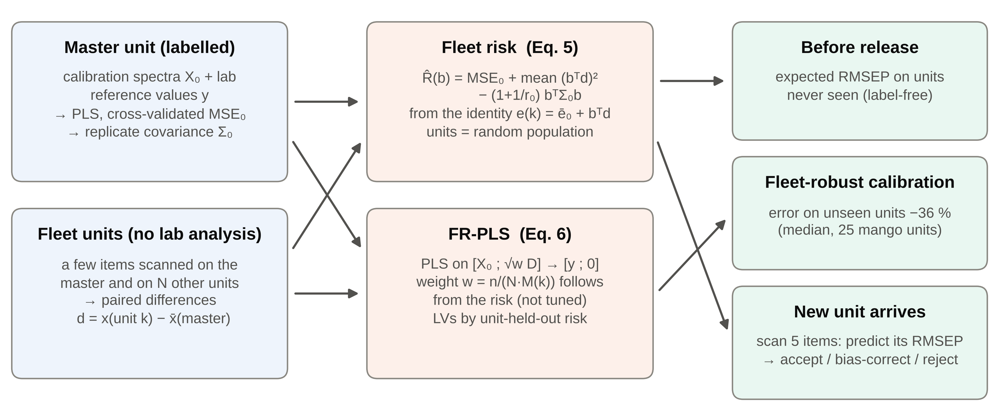
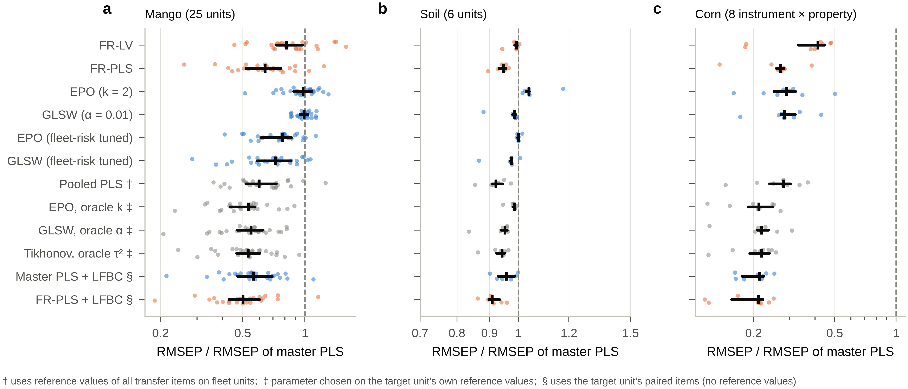

**P N Bhargav Teja**^a,\*^, **[Second Author]**^b^

^a^ [Affiliation of P N Bhargav Teja, City, Country]
^b^ [Affiliation of Second Author, City, Country]

\* Corresponding author. E-mail address: [corresponding e-mail]

## Highlights

- Handheld NIR units are treated as a random population, not as master–slave pairs.
- An exact identity predicts a model's RMSEP on any unit without reference analyses.
- Predicted and realised errors agree (r = 0.98) across 62 handheld mango units.
- Fleet-risk PLS cuts error on unseen units by 41 % with no tuning or target labels.
- Five paired items qualify a new unit: accept, bias-correct or reject, lab-free.

## Graphical abstract

{width=100%}

## Abstract

**Background:** Handheld near-infrared (NIR) spectrometers are deployed as fleets of nominally identical units, but a calibration built on one unit is used on all of them, including units bought later. Calibration transfer has been developed for pairs of instruments and judged with reference values measured on the secondary instrument. Fleet operators cannot answer three questions without laboratory analyses on every unit: how accurate a calibration will be on units never seen, how to build a calibration for the fleet rather than the master, and whether a newly delivered unit is fit for use.

**Results:** We treat the units of a fleet as a random population and show that an exact error identity yields an unbiased, label-free estimate of the error of any linear calibration on a given unit and on unseen units, using only the master's cross-validation and replicate scans and a few items scanned on several units. Minimising this fleet risk gives fleet-risk PLS (FR-PLS), whose regularisation weight is fixed by theory. In leave-one-unit-out deployment on 31 handheld mango dry-matter units (85 401 spectra, six seasons), the predicted unit errors agreed with realised errors (r = 0.98, median deviation 7 %), FR-PLS reduced the error on unseen units by 41 % and matched a fully labelled multi-instrument calibration, and five fruit scanned on a new unit sufficed to predict its error and to remove most of it by bias correction. [SOIL] Results were confirmed on a three-instrument corn benchmark.

**Significance:** Fleet calibration converts the deployment of a NIR calibration across many handheld units from a trial-and-error exercise into a quantified, laboratory-free procedure: a calibration is released with its expected error on future units, built to minimise that error, and every new unit is qualified from five paired scans.

**Keywords:** Calibration transfer; Handheld NIR spectroscopy; Instrument fleet; Partial least squares; Prediction error; Model robustness

## 1. Introduction

Near-infrared (NIR) spectroscopy has moved from the laboratory bench to the field [@Pasquini2018; @Bec2021]. Handheld and miniaturised spectrometers are now sold in quantity and operated as *fleets*: dozens of nominally identical units are used by growers, packhouses, soil-testing services and regulators, each expected to give the same answer for the same sample. The Australian mango industry, for example, sets harvest timing from dry-matter (DM) predictions made in-orchard with handheld short-wave NIR units [@Walsh2020; @Anderson2020; @Anderson2021], and handheld MEMS FT-NIR units are being adopted for farm-scale soil-carbon monitoring [@Sanderman2025; @Mitu2024; @Partida2025]. In both cases a single calibration, developed with laboratory reference analyses on one or a few units, is distributed to every unit in the fleet, including units that are bought after the calibration was made.

Unit-to-unit differences in wavelength registration, detector gain, optical throughput and bandwidth make this distribution risky [@Workman2018; @Hayes2016; @Greensill2002]. The classical answer is calibration transfer: measure transfer (standardisation) samples on a master and a slave instrument and correct either the spectra (direct and piecewise direct standardisation, PDS [@Wang1991; @Bouveresse1996]), the predictions (slope/bias correction) or the model (orthogonal projections, EPO, TOP, GLSW, Tikhonov regularisation, domain-invariant PLS [@Roger2003; @Andrew2004; @Martens2003; @Kalivas2009; @NikzadLangerodi2018AC]). Recent work in this journal has continued to refine the master–slave problem, for example standard-free transfer by likelihood maximisation [@UCTLMIR2026], two-stage PDS-plus-fine-tuning [@PDSFT2026] and transfer protocols for multisensor systems [@Multisensor2026]. Across this literature the object of study is one *pair* of instruments (occasionally three to six [@Woody2004; @Ciza2022; @Zhang2022; @Robert2024]), and the performance of a transfer method is judged on the slave it was tuned on, usually with labelled slave samples used to choose its parameters.

Fleets pose three questions this paradigm does not answer. First, **before** a calibration is released: how accurate will it be on units that have never been seen — and can this be known without sending samples to a laboratory for every unit? Second, how should the calibration itself be built so that it is accurate across the *population* of units, rather than on the master? Third, when a new unit arrives: is it fit for purpose as is, after a simple correction, or not at all — and how many samples are needed to decide? The largest fleet study to date standardised 66 milk mid-infrared analysers to a master one at a time [@Grelet2017]; mixed-effects models have been used for site effects in soil spectroscopy [@Potash2026]; and multi-unit handheld studies report that cross-unit performance degrades [@Mitu2024; @Sun2019]. None treats the units as a random sample from a population, predicts the error on an unseen unit, or derives a calibration objective from that population.

This paper develops such a framework — *fleet calibration* — and tests it on what are, to our knowledge, the two largest public multi-unit NIR data sets: 85 401 spectra of mango fruit measured with 31 handheld units over seven seasons, in which thousands of fruit were scanned on up to eleven units [@MangoData], and 36 622 spectra of 2 106 soils measured with seven handheld MEMS FT-NIR units [@NeoSpectraData], complemented by the classical three-instrument corn benchmark. The contributions are:

1. an exact error identity and an unbiased, **label-free estimator of the error a calibration will have on an unseen unit** (fleet risk) and on a specific unit (unit risk), computed only from the master's cross-validation, the master's replicate scans and items scanned on the master and on other units;
2. **fleet-risk PLS (FR-PLS)**, a calibration that minimises the estimated fleet risk, whose regularisation weight is fixed by theory rather than tuned on labelled target data, and a fleet-risk criterion for choosing the number of latent variables;
3. a **label-free qualification rule** for a newly delivered unit (accept / bias-correct / re-calibrate) and the number of paired items it requires;
4. **fleet design curves** — how much the number of fleet units and of paired items matter — and a physical decomposition of unit effects into offset, gain and wavelength-shift components.

The framework is deliberately linear and PLS-based: it adds no new hyper-parameters to the workflow analysts already use [@OldAdvice2026; @Validation2026], and its outputs (an expected RMSEP and a decision per unit) are the quantities a fleet operator needs.

## 2. Theory

### 2.1. The fleet as a population of instruments

Consider a fleet of nominally identical spectrometers (units) $k = 0, 1, 2, \dots$, of which unit 0 (the *master*) carries a calibration built from $n$ labelled scans $(\mathbf{x}_{0j}, y_j)$. A linear calibration (PLS or any other linear model) predicts $\hat y = b_0 + \mathbf{b}^\top \mathbf{x}$ from a pre-processed spectrum. We write a single scan of item $i$ on unit $k$ as

$$\mathbf{x}_{ik} = \mathbf{s}_i + \mathbf{a}_{ik} + \boldsymbol{\varepsilon}_{ik}, \qquad \mathbf{a}_{i0} \equiv \mathbf{0}, \tag{1}$$

where $\mathbf{s}_i$ is the master's noise-free response to item $i$, $\mathbf{a}_{ik}$ is the *unit effect* (offset, gain, wavelength-axis and bandwidth differences; it may depend on the item through gain-type terms) and $\boldsymbol{\varepsilon}_{ik}$ is scan-to-scan variation (detector noise and re-positioning) with covariance $\boldsymbol{\Sigma}_k$. The fleet is regarded as a random sample from the population of units the manufacturer produces; a unit that will be bought next year is a new draw from the same population. The quantity a user needs before deployment is therefore not the error on a particular slave instrument, but the expected squared error on a *randomly drawn unseen unit*, which we call the **fleet risk**

$$R_\mathrm{F}(\mathbf{b}) = \mathbb{E}_{k}\,\mathbb{E}_{i,\varepsilon}\big[(b_0 + \mathbf{b}^\top\mathbf{x}_{ik} - y_i)^2\big]. \tag{2}$$

### 2.2. An exact identity and a label-free risk estimator

Let item $i$ be scanned $r_0$ times on the master (mean spectrum $\bar{\mathbf{x}}_{i0}$) and once on unit $k$, and let $\mathbf{d}_{ik} = \mathbf{x}_{ik} - \bar{\mathbf{x}}_{i0}$ be the *paired difference*. Then, purely algebraically,

$$e_{ik} = \bar e_{i0} + \mathbf{b}^\top \mathbf{d}_{ik}, \tag{3}$$

where $e$ denotes a prediction error. Eq. (3) is the familiar statement that a spectral perturbation changes a linear prediction by its projection on $\mathbf{b}$ [@Olivieri2006; @Lorber1997]; it is the starting point of slope/bias checks between paired instruments [@Mark2018; @Grelet2017]. Its use here is different: taking expectations under model (1) with independent scan noise gives (Supplementary S1)

$$\mathbb{E}[e_{ik}^2] = \mathrm{MSE}_0 + \mathbb{E}\big[(\mathbf{b}^\top\mathbf{d}_{ik})^2\big] - \Big(1+\tfrac{1}{r_0}\Big)\mathbf{b}^\top\boldsymbol{\Sigma}_0\mathbf{b} + 2\,\mathbb{E}\big[(\mathbf{b}^\top\mathbf{s}_i + b_0 - y_i)\,\mathbf{b}^\top\mathbf{a}_{ik}\big], \tag{4}$$

with $\mathrm{MSE}_0$ the single-scan error on the master. Every term except the last can be estimated **without reference values on any unit other than the master**: $\mathrm{MSE}_0$ by (grouped) cross-validation on the master, $\mathbb{E}[(\mathbf{b}^\top\mathbf{d})^2]$ from items scanned on both the master and fleet units, and $\boldsymbol{\Sigma}_0$ from the master's replicate scans. The last term vanishes when the unit effect is uncorrelated with the master's chemical residual, which is the case for additive unit effects and, to first order, for gain effects on a well-fitted model; it can be tested with labelled pairs (Section 4.2). Dropping it, the label-free estimator for unit $k$ and for the fleet are

$$\hat R_k(\mathbf{b}) = \widehat{\mathrm{MSE}}_0 + \frac{1}{M_k}\sum_{i}(\mathbf{b}^\top\mathbf{d}_{ik})^2 - \Big(1+\tfrac{1}{r_0}\Big)\mathbf{b}^\top\hat{\boldsymbol{\Sigma}}_0\mathbf{b}, \qquad \hat R_\mathrm{F}(\mathbf{b}) = \frac{1}{N}\sum_{k=1}^{N}\hat R_k(\mathbf{b}). \tag{5}$$

Because units, not scans, are the sampling unit of the population, $\hat R_\mathrm{F}$ weights each fleet unit equally, its uncertainty is obtained by resampling units, and an order-statistic interval of the $\hat R_k$ gives a distribution-free prediction interval for the risk of the *next* unit (with $N$ exchangeable units, $[\hat R_{(j)}, \hat R_{(N+1-j)}]$ covers it with probability $(N+1-2j)/(N+1)$).

Splitting the mean of $\mathbf{b}^\top\mathbf{d}_{ik}$ from its variance decomposes the unit risk into the master error, a **bias** term $(\mathbf{b}^\top\bar{\mathbf{d}}_k)^2$ and a **sample-dependent** term. The bias term is removed exactly by a label-free bias correction (LFBC), $b_0 \leftarrow b_0 - \mathbf{b}^\top\bar{\mathbf{d}}_k$, computed from a handful of items scanned on the new unit and the master; the corrected risk is predicted by Eq. (5) with the squared mean removed. This yields a three-way decision rule for a new unit that requires no laboratory analysis: *accept* if $\hat R_k^{1/2}$ is within specification, *bias-correct* if only $\hat R_k^{\mathrm{LFBC}\,1/2}$ is, otherwise *re-calibrate*.

### 2.3. Fleet-risk-minimising calibration

Eq. (4) also says which calibration is best for the fleet. Replacing the expectations by their sample versions and ignoring the (small, $\mathbf{b}$-shrinking) noise-correction term, the empirical fleet risk of a model is the master residual sum of squares plus $n$ times the mean squared projection of the paired differences. Its minimiser is the least-squares solution of the augmented system

$$\begin{bmatrix}\mathbf{X}_0 - \mathbf{1}\bar{\mathbf{x}}_0^\top\\ \mathbf{W}^{1/2}\mathbf{D}\end{bmatrix}\mathbf{b} \approx \begin{bmatrix}\mathbf{y} - \bar y\mathbf{1}\\ \mathbf{0}\end{bmatrix}, \qquad w_{ik} = \frac{n}{N\,M_k}, \tag{6}$$

where $\mathbf{D}$ stacks the paired differences of all fleet units (not re-centred, so that unit offsets are penalised) and the weights give every unit the same total influence. We solve Eq. (6) with PLS and call the result **fleet-risk PLS (FR-PLS)**. Eq. (6) has the form of Tikhonov-regularised calibration transfer [@Kalivas2009; @Kunz2010JC; @Kalivas2012], but with two differences that matter in practice: (i) the regularisation weight is not a tuning parameter — it is fixed at $w_{ik} = n/(NM_k)$ by the risk being minimised, so that no labelled target samples are needed to choose it; and (ii) the difference block pools many units, so that the calibration is made insensitive to the *population* of unit effects rather than to one secondary instrument. Projection methods such as EPO [@Roger2003], TOP [@Andrew2004] and GLSW [@Martens2003] are hard-threshold or re-weighted limits of the same idea, each with a free parameter.

The number of latent variables is chosen to minimise $\hat R_\mathrm{F}$, not the master's cross-validation error. For FR-PLS this is done by *unit-held-out cross-validation*: in fold $f$ the model is fitted without master fold $f$ and without the paired differences of a group of fleet units, and the quadratic term of Eq. (5) is evaluated on the held-out units only, so that no difference spectrum is used both to fit and to assess the model. Applied to the ordinary master PLS, the same criterion (FR-LV) changes only the number of latent variables and needs no refitting.

## 3. Materials and methods

### 3.1. Data sets

**Mango dry matter (31 handheld units).** The public mango DM data set (version 4; [@MangoData]) contains 85 401 Vis-SWNIR interactance spectra (300–1200 nm, 3 nm steps) acquired in Australian orchards from 2015 to 2021 with 31 handheld units of the same commercial model (identified by serial number), together with oven-dry DM of each fruit (13 953 fruit). Many fruit were scanned on several units (up to eleven), typically twice per unit at different positions; this crossed design, collected to support robust calibration [@Anderson2020; @Anderson2021], is what makes a population-level analysis possible. Spectra flagged as outliers by the data owners were excluded. Each season was analysed separately (seasons 2015–2020; 2021 has only four units), so that unit effects are not confounded with between-season changes in fruit population. Pre-processing followed the established mango workflow: Savitzky–Golay second derivative (window 13, quadratic) [@Savitzky1964] on 684–990 nm.

**Soil properties (seven handheld MEMS FT-NIR units).** The NeoSpectra soil library [@NeoSpectraData; @Partida2025] contains NIR spectra (1350–2550 nm) of 2 106 archived, dried and sieved mineral soils from the USDA-NRCS Kellogg Soil Survey Laboratory, scanned (six replicate scans) on nine handheld units by two laboratories, with laboratory reference values. Seven units used the same direct-contact configuration (NEO1–NEO7; 36 622 scans) and constitute the fleet; two units used a different sample accessory and shared ≤ 11 soils with the others and were excluded. Six properties were modelled: organic carbon (OC), total N and cation-exchange capacity (CEC) on a $\log_{10}(x+0.1)$ scale, clay, sand and pH. Spectra were converted to absorbance, standard normal variate-transformed [@Barnes1989] and differentiated (Savitzky–Golay first derivative, window 11).

**Corn (three benchtop instruments).** The classical corn benchmark (80 samples measured on instruments m5, mp5 and mp6, moisture, oil, protein and starch) was included as a small, laboratory-instrument case; Savitzky–Golay first derivative (window 15) was applied.

All pre-processing steps act row-wise and have no fitted parameters, so they cannot carry information between units or between calibration and test items.

### 3.2. Leave-one-unit-out deployment protocol

For each data set (mango season or soil property), the master was chosen by a fixed label-free rule — the unit sharing the most items with other units. Items scanned on the master and on at least one other unit were randomly split into three equal parts: *transfer* items (their scans on the master and fleet units provide the paired differences $\mathbf{D}$; their reference values are never used by label-free methods), *paired test* items and calibration items; items scanned only on the master were added to the calibration set and items never scanned on the master to the test set. Each non-master unit in turn played the role of the **unseen target unit**: it was removed from the fleet, all models and all fleet-risk estimates were computed from the master and the remaining units only, and the realised error was then measured on the target's scans of test items. Errors are reported on paired test items (items also scanned on the master, so that the comparison isolates the unit effect) and, for mango, also on all test items, which adds orchard-population differences. The split was repeated with five seeds (twenty for corn) and results were averaged per target unit before any statistics, so that the target unit — the population sampling unit — is the unit of inference. In total the protocol evaluates 56 mango target-unit/season combinations, 36 soil target-unit/property combinations and 8 corn combinations.

The latent-variable number of the master PLS (NIPALS PLS1 [@Wold2001]) was selected by grouped 5-fold cross-validation over items with the one-standard-error rule [@Validation2026]; grouping by item keeps the replicate scans of a fruit or soil in the same fold.

### 3.3. Compared calibrations

Label-free methods, which use only the master's labelled data and paired spectra of transfer items on fleet units, were: (i) the master PLS (conventional practice); (ii) FR-LV, the same model with the number of latent variables chosen by minimum $\hat R_\mathrm{F}$; (iii) FR-PLS (Section 2.3); (iv) EPO with $k$ difference components [@Roger2003] and (v) GLSW with parameter $\alpha$ [@Martens2003], both computed from the same difference matrix $\mathbf{D}$. For EPO and GLSW we report a commonly used default ($k=2$; $\alpha = 0.01$ relative to the largest eigenvalue) and an **oracle** setting — the value from a grid ($k \in \{1,\dots,10\}$; $\alpha \in [10^{-4}, 1]$) that gives the lowest error *on the target unit itself*. Two reference methods use information a fleet operator would not normally have: (vi) Tikhonov transfer [@Kalivas2009] — Eq. (6) with free weight $\tau^2 w_{ik}$, $\tau^2 \in [0.01, 100]$ — with oracle-tuned $\tau^2$, and (vii) pooled PLS, calibrated on the master data plus the fleet scans of the transfer items **with** their reference values (the classical multi-instrument calibration [@Swierenga2000]). Oracle settings are optimistic by construction and serve as upper bounds on what tuning could achieve. Finally, label-free bias correction (LFBC, Section 2.2) was applied to the master PLS and FR-PLS using the target unit's own scans of transfer items (on average 10–300 items per unit; Section 4.4 studies how few are needed).

### 3.4. Evaluation and statistics

The accuracy of a risk prediction was assessed by the Pearson and Spearman correlations between predicted and realised RMSEP across target units, the median ratio predicted/realised and the median absolute percentage error; fleet-level predictions were compared with the root-mean-square of realised RMSEP over all target units of a data set. Methods were compared on paired-test RMSEP per target unit by the Wilcoxon signed-rank test [@Wilcoxon1945] on log-ratios, with Holm correction across the comparisons made within a data-set family; effect sizes are reported as median RMSEP ratios and win rates. Unit-effect spectra were decomposed by regressing each unit's mean paired difference (raw absorbance) on a constant, the master's mean spectrum and its first and second wavelength derivatives, which correspond to offset, gain, wavelength-shift and bandwidth differences.

All computations were done in Python 3.13 (NumPy, SciPy, scikit-learn) with a PLS1 implementation verified against scikit-learn; unit tests check the exact identity of Eq. (3) and the unbiasedness of Eq. (5) on simulated fleets with known unit-effect covariance.

## 4. Results and discussion

### 4.1. The fleet problem is large and mostly a bias problem

Within the mango fleet, the master calibrations were as good as published single-instrument mango models (grouped cross-validated RMSE 0.63–1.05 %DM, 12 latent variables on average). Deployed unchanged on the other units of the same season, the same calibrations gave RMSEP between 0.81 and 6.9 %DM on fruit that had also been scanned on the master (root-mean-square over the 62 target units with paired test fruit: 2.39 %DM, i.e. 2.8 times the master's own error). Most of this excess is a unit-specific bias: removing each unit's mean prediction offset with its own paired fruit (LFBC) reduced the RMS error to 1.15 %DM. The decomposition of the unit-effect spectra (Fig. 5) shows why. For the silicon photodiode-array units, a constant offset, a gain term, a wavelength-axis shift and a bandwidth term explained a median of 91 % of the mean difference spectrum between a unit and the master, with gain differences contributing most; these are exactly the hardware tolerances of short-wave NIR units identified by Hayes et al. [@Hayes2016] and Greensill and Walsh [@Greensill2002]. A second-derivative calibration removes the offset but not gain, shift or bandwidth differences, which project onto the regression vector and appear as bias. The handheld MEMS FT-NIR soil fleet was very different: its unit-difference spectra were five times smaller (median RMS 0.0096 vs 0.050 absorbance units) and only 27 % structured, i.e. close to noise — the soil fleet therefore serves as a natural *negative control* for the methods below.

### 4.2. The error on a unit can be predicted without reference analyses

Fig. 2a compares, for every target unit, the RMSEP predicted by Eq. (5) — from the master's cross-validation, its replicate scans and the unit's own scans of transfer items, with no reference value from that unit — with the RMSEP realised on independent paired test fruit. For the master PLS the agreement is close over almost an order of magnitude of error: Pearson r = 0.98 (Spearman 0.96) across the 62 mango target units, median ratio predicted/realised 0.99 and median absolute error of the prediction 6.9 %; for corn (8 instrument/property cases) r = 1.00 and the median error was 0.7 %. The prediction is equally good after the calibration has been made fleet-robust (FR-LV and FR-PLS; r = 0.85–0.87 for mango, where the remaining spread between units is much smaller, and 0.996–0.999 for corn). Agreement holds because Eq. (3) is exact; the only approximations are the dropped cross-term and the sampling error of a finite number of paired items. The near-unit ratio indicates that the cross-term is negligible for these data even though gain differences, which make the unit effect sample-dependent, dominate the mango fleet.

The same estimator, averaged over the fleet, predicts the error on a unit that contributes nothing. In leave-one-unit-out deployment the predicted fleet RMSEP of the master PLS was 2.42 %DM against a realised 2.40 %DM (median ratio 1.00 over 310 unit × split cases), and the range of the other units' risks contained the new unit's realised error in 77 % of cases, close to the nominal (N−1)/(N+1) of 85–90 % for fleets of 10–22 units. This is the first quantity a fleet operator needs and, to our knowledge, it has not previously been obtainable before deployment: with a few dozen fruit scanned on several units, the expected error of a calibration on units that will be bought later is known without a single additional laboratory analysis.

### 4.3. Calibrating for the fleet instead of the master

Fig. 3 compares the deployed error of the calibration strategies relative to the master PLS. Choosing the number of latent variables by fleet risk instead of master cross-validation (FR-LV) already reduced the error (RMS 1.82 vs 2.39 %DM) at no cost: the model is not refitted, and the criterion selected on average fewer latent variables (10.6 vs 11.7), i.e. it stopped before components that mainly fit unit-sensitive spectral structure. Building the fleet into the calibration (FR-PLS, Eq. (6)) reduced the RMS error to 1.40 %DM (−41 %; FR-PLS better than the master on 81 % of the 89 target-unit/season cases, median RMSEP ratio 0.68, Holm-adjusted p < 10⁻⁴). EPO and GLSW computed from the same difference spectra, at their default settings, did not improve on the master (RMS 2.25 and 2.28 %DM; FR-PLS better in 79 % and 83 % of cases, p < 10⁻⁴), which illustrates the practical difficulty that a projection method's parameter must be tuned for each fleet.

To place FR-PLS against the best that tuning could achieve, we gave the competitors information a fleet operator does not have. With the parameter chosen *per target unit using that unit's own reference values*, GLSW reached 1.32 %DM (indistinguishable from FR-PLS, p = 0.44), EPO 1.15 %DM and Tikhonov transfer 1.10 %DM; pooled PLS, which requires reference values for every transfer fruit scanned on every fleet unit, reached 1.34 %DM (FR-PLS vs pooled, p = 0.15). FR-PLS therefore reaches the accuracy of a fully labelled multi-instrument calibration and of an oracle-tuned GLSW with no labelled data beyond the master's calibration set and no tuning; the residual gap to oracle-tuned EPO/Tikhonov (≈ 15 %) is the price of not tuning on the target. The Tikhonov oracle selected weights from 0.01 to 100 times the theoretical value across targets, with no systematic direction, confirming that the theoretical weight $\tau^2 = 1$ is the appropriate unbiased choice when the target is unknown.

On the three-instrument corn benchmark the ranking was the same (RMS over the eight instrument/property cases: master 1.35, FR-LV 0.48, FR-PLS 0.38, pooled 0.36, GLSW-oracle 0.33, EPO-oracle 0.29, Tikhonov-oracle 0.27, in property units), with FR-PLS better than the master in all eight cases. With one-unit fleets, however, the predicted fleet risk of FR-PLS was optimistic (ratio 0.71), and the same was seen for mango when the fleet was artificially reduced to one or two units (Section 4.4): a single secondary instrument cannot represent a population of instruments.

### 4.4. How many units and how many items?

Fig. 4a shows the effect of the number of fleet units that contribute paired spectra to FR-PLS (mango 2016–2018, 33 target units, three random unit subsets per size). One unit already reduced the error on unseen units substantially (RMS 1.50 vs 1.85 %DM for the master), and the error decreased further up to about eight units (1.26 %DM), beyond which little was gained. The fleet-risk *prediction*, in contrast, was clearly optimistic with one or two units (0.80 %DM predicted) and became reliable from four units on (1.15 %DM predicted vs 1.26–1.40 realised). The design rule is therefore asymmetric: a calibration benefits from paired spectra of even one other unit, but the *claimed* fleet accuracy should be backed by at least four units. The number of paired items per unit mattered little: three items per unit gave the same FR-PLS accuracy as all available items (1.27 vs 1.24 %DM).

Fig. 4b shows the qualification of a new unit as a function of the number $m$ of items scanned on it and on the master. With a single fruit, label-free bias correction reduced the master PLS error on the new unit from 1.85 to 1.06 %DM and the FR-PLS error from 1.24 to 0.87 %DM; three to five fruit gave 0.96–0.97 and 0.82–0.83 %DM, and more fruit gave little further gain. The predicted risk of the uncorrected unit was useful from the first items on: with five fruit, the label-free unit risk correlated with the realised RMSEP at r = 0.95 (Spearman 0.88; median over repeated draws of the fruit, single draw per unit) with a median absolute error of 16 %, improving to r = 0.97 and 11 % with 20 fruit. A practical protocol for a new unit is therefore: scan five fruit (or soils, tablets) on the new unit and on the master, compute $\hat R_k$ and $\hat R_k^{\mathrm{LFBC}}$, and accept, bias-correct or reject the unit — at no laboratory cost.

## 5. Conclusions

Handheld NIR spectrometers are deployed as fleets, yet calibration transfer has been studied as a problem between pairs of instruments. Treating the units of a fleet as a random sample from a population turns three questions that previously required reference analyses on every unit into quantities that can be computed from spectra alone. (i) An exact error identity gives a label-free estimate of the RMSEP of a linear calibration on a specific unit and on units not yet seen; across 62 handheld mango units it agreed with the realised RMSEP at r = 0.98 (median deviation 7 %), and the fleet-level prediction matched the realised error within 1 %. (ii) Minimising that risk gives fleet-risk PLS, whose regularisation weight is fixed by theory; it reduced the error on unseen units by 41 % relative to the master calibration and matched a fully labelled multi-instrument calibration and an oracle-tuned GLSW without tuning or target labels. (iii) Five items scanned on a new unit and on the master suffice to predict the unit's error and to remove most of it by bias correction, yielding a laboratory-free accept / correct / reject decision. Design curves show that paired spectra from even one other unit help the calibration, while a reliable *claim* of fleet accuracy needs at least four units. A near-homogeneous MEMS FT-NIR soil fleet behaved as a negative control: the estimator correctly predicted that little was to be gained.

The framework is linear, adds no hyper-parameter to the PLS workflow and uses data that fleet operators can collect at negligible cost. Its limitations follow from its assumptions: the fleet must be representative of future units (an atypical unit is detected by the qualification step, not prevented by FR-PLS), and drift of a unit over time or across seasons is outside the present scope. Extending the population view to time — units as random draws in space, seasons as random draws in time — and to non-linear calibrations through the same identity applied to local linearisations are natural next steps.

## CRediT authorship contribution statement

**P N Bhargav Teja:** Conceptualization, Methodology, Software, Formal analysis, Investigation, Data curation, Visualization, Writing – original draft, Writing – review & editing. **[Second Author]:** [Contribution roles to be completed].

## Declaration of competing interest

The authors declare that they have no known competing financial interests or personal relationships that could have appeared to influence the work reported in this paper.

## Funding

This research did not receive any specific grant from funding agencies in the public, commercial, or not-for-profit sectors.

## Declaration of generative AI and AI-assisted technologies in the writing process

During the preparation of this work the authors used an AI assistant for code development support and language editing. After using this tool, the authors reviewed and edited the content as needed and take full responsibility for the content of the published article.

## Data availability

All spectra and reference values analysed in this study are publicly available: mango dry matter data, Mendeley Data, doi:10.17632/46htwnp833 (CC BY 4.0); NeoSpectra handheld soil library, Zenodo, doi:10.5281/zenodo.13122321 (CC BY 4.0); corn data set, Eigenvector Research (https://eigenvector.com/resources/data-sets/). Code will be made available on request.

## Figure captions

**Fig. 1.** Fleet calibration workflow. Only the master unit requires laboratory reference values. Items scanned on the master and on other units of the fleet provide paired difference spectra, from which the error of any linear calibration on unseen units is predicted (Eq. (5)) and minimised (FR-PLS, Eq. (6)); a new unit is qualified from five paired items without laboratory analysis.

{width=100%}

**Fig. 2.** Label-free prediction of the error of a calibration on an individual unit. Predicted RMSEP (Eq. (5), using only the master's cross-validation and replicate scans and the unit's scans of transfer items) against the RMSEP realised on independent paired test items, for (a) the master PLS and (b) FR-PLS. Each point is one target unit (averaged over item-split repetitions); dashed line, identity. Log–log axes.

{width=100%}

**Fig. 3.** Error on unseen units relative to the master PLS (leave-one-unit-out; paired test items). Points, individual target units; bars, interquartile range; ticks, median. Methods marked * use information unavailable in label-free deployment (oracle: parameter chosen on the target unit's own reference values; pooled: reference values of all transfer items on all fleet units).

{width=100%}

**Fig. 4.** Design curves for the mango fleet (seasons 2016–2018, 33 target units). (a) RMSEP of FR-PLS on unseen units and its label-free prediction against the number of fleet units contributing paired spectra (three random unit subsets per size). (b) Qualification of a new unit: RMSEP after label-free bias correction (LFBC) and its prediction against the number of items scanned on the new unit and the master (ten random draws per size); dotted lines, uncorrected RMSEP.

{width=100%}

**Fig. 5.** Physical structure of unit effects. Fraction of each unit's mean paired difference spectrum (unit minus master, raw absorbance) explained by offset, gain, wavelength-shift and bandwidth terms, against the size of the difference. Mango units: one point per unit and season (2016–2018); soil units: one point per unit.

{width=60%}

## References

::: {#refs}
:::
